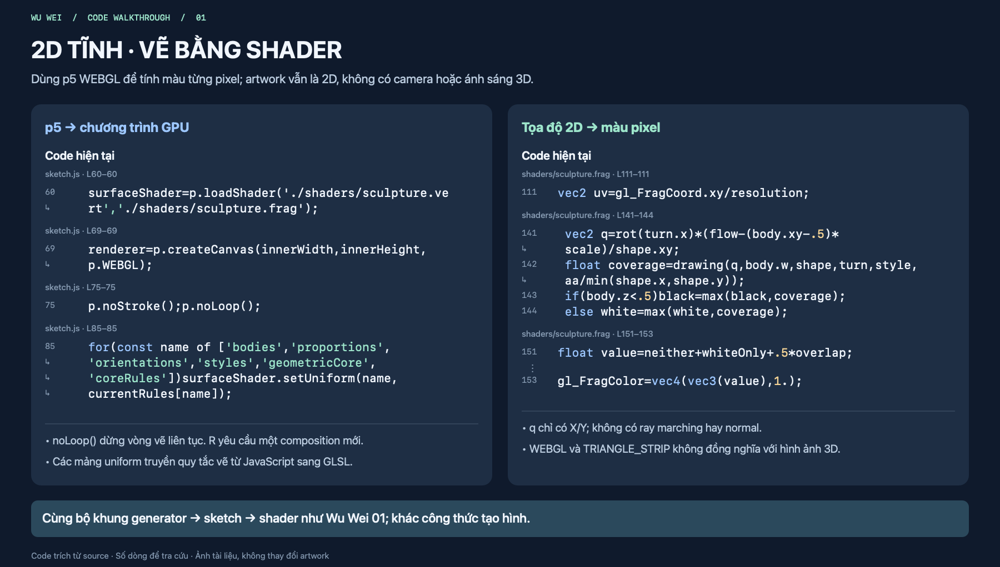
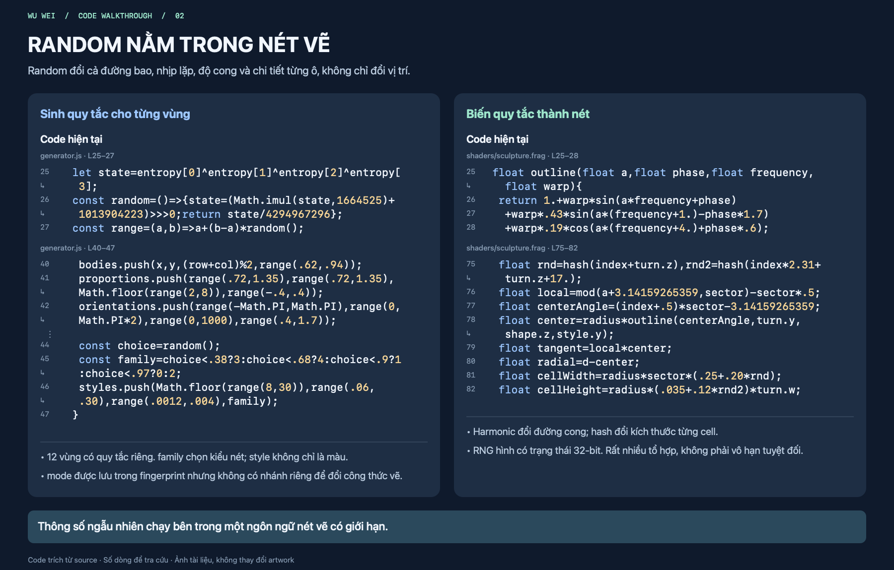
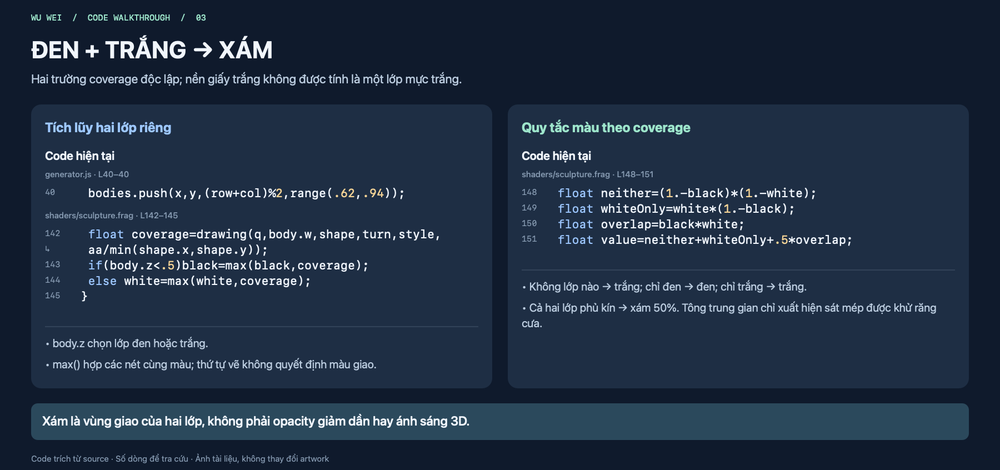
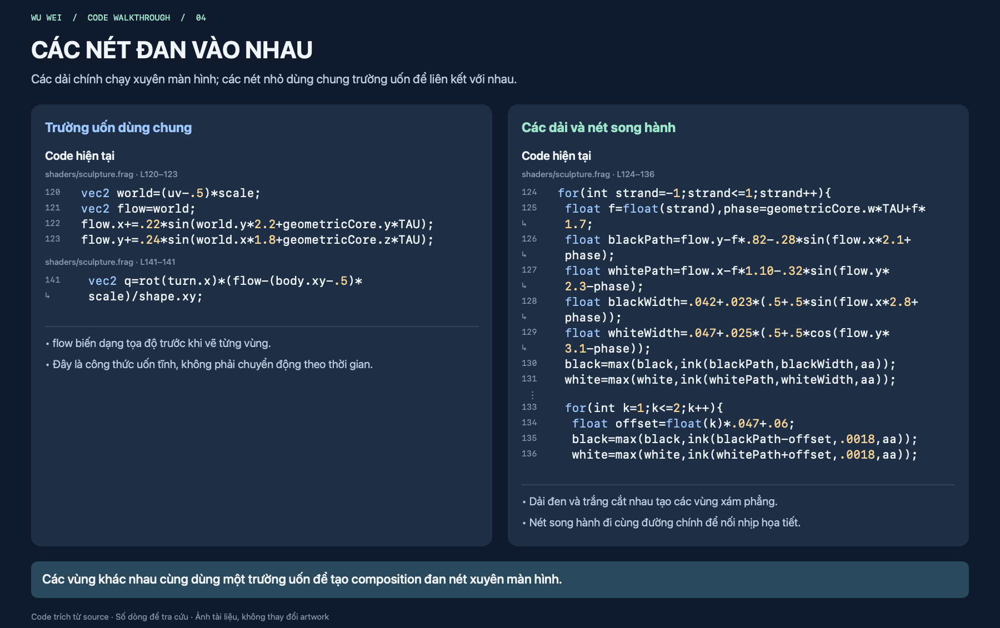
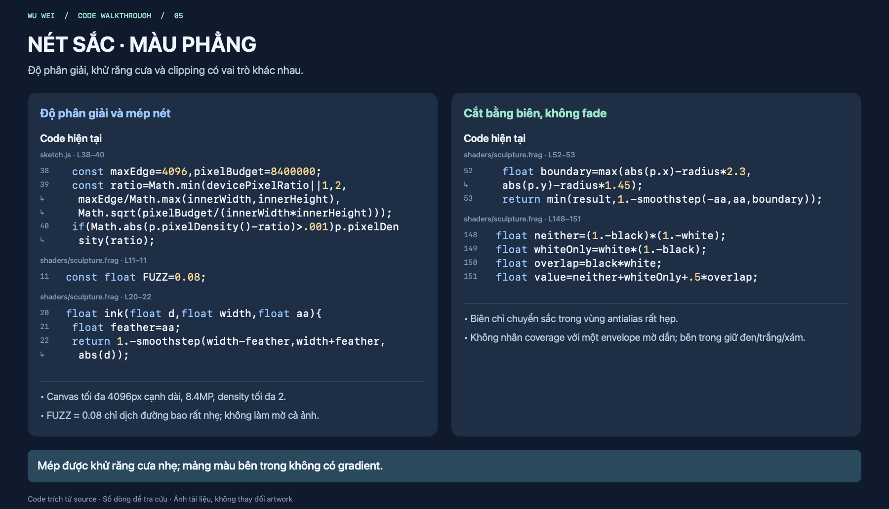
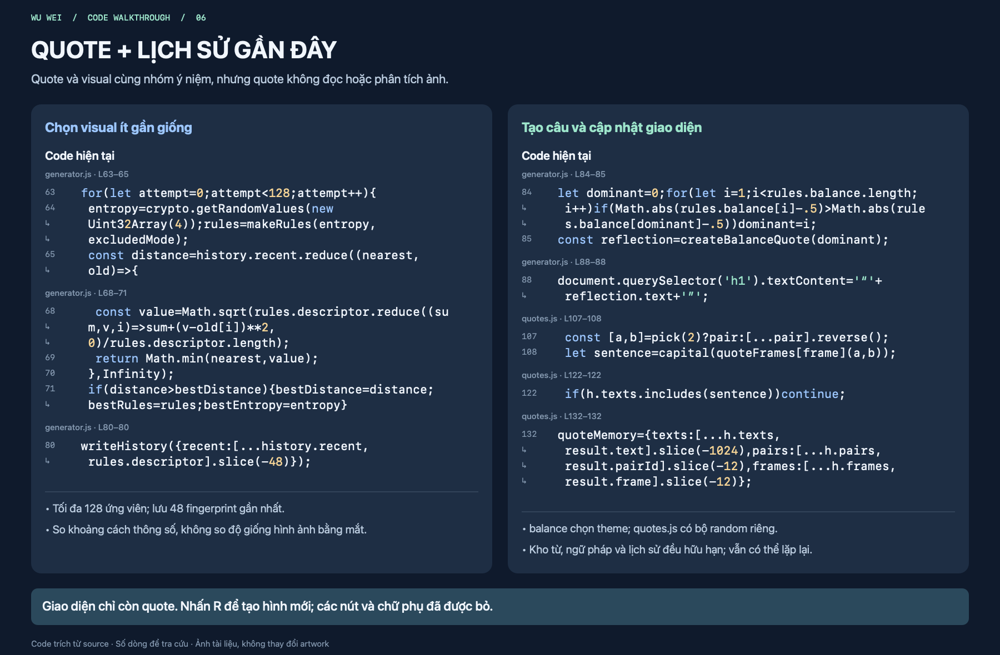

# Bộ ảnh giải thích code Wu Wei Variation

6 ảnh có chú thích và 10 ảnh code thuần trong `plain/`, cùng phong cách bộ Wu Wei gốc. Ảnh render từ source thật, có số dòng; không phải chụp cửa sổ editor. Không thay đổi code chạy.

Ảnh phản ánh bản hiện tại: 2D tĩnh, dải đan tự do, màu đen/trắng/xám phẳng, nét sắc; chưa áp dụng lại bản pattern lặp đã hoàn tác.

## 2D TĨNH · VẼ BẰNG SHADER

Dùng p5 WEBGL để tính màu từng pixel; artwork vẫn là 2D, không có camera hoặc ánh sáng 3D.

**p5 → chương trình GPU**
- noLoop() dừng vòng vẽ liên tục. R yêu cầu một composition mới.
- Các mảng uniform truyền quy tắc vẽ từ JavaScript sang GLSL.

**Tọa độ 2D → màu pixel**
- q chỉ có X/Y; không có ray marching hay normal.
- WEBGL và TRIANGLE_STRIP không đồng nghĩa với hình ảnh 3D.

Cùng bộ khung generator → sketch → shader như Wu Wei 01; khác công thức tạo hình.

## RANDOM NẰM TRONG NÉT VẼ

Random đổi cả đường bao, nhịp lặp, độ cong và chi tiết từng ô, không chỉ đổi vị trí.

**Sinh quy tắc cho từng vùng**
- 12 vùng có quy tắc riêng. family chọn kiểu nét; style không chỉ là màu.
- mode được lưu trong fingerprint nhưng không có nhánh riêng để đổi công thức vẽ.

**Biến quy tắc thành nét**
- Harmonic đổi đường cong; hash đổi kích thước từng cell.
- RNG hình có trạng thái 32-bit. Rất nhiều tổ hợp, không phải vô hạn tuyệt đối.

Thông số ngẫu nhiên chạy bên trong một ngôn ngữ nét vẽ có giới hạn.

## ĐEN + TRẮNG → XÁM

Hai trường coverage độc lập; nền giấy trắng không được tính là một lớp mực trắng.

**Tích lũy hai lớp riêng**
- body.z chọn lớp đen hoặc trắng.
- max() hợp các nét cùng màu; thứ tự vẽ không quyết định màu giao.

**Quy tắc màu theo coverage**
- Không lớp nào → trắng; chỉ đen → đen; chỉ trắng → trắng.
- Cả hai lớp phủ kín → xám 50%. Tông trung gian chỉ xuất hiện sát mép được khử răng cưa.

Xám là vùng giao của hai lớp, không phải opacity giảm dần hay ánh sáng 3D.

## CÁC NÉT ĐAN VÀO NHAU

Các dải chính chạy xuyên màn hình; các nét nhỏ dùng chung trường uốn để liên kết với nhau.

**Trường uốn dùng chung**
- flow biến dạng tọa độ trước khi vẽ từng vùng.
- Đây là công thức uốn tĩnh, không phải chuyển động theo thời gian.

**Các dải và nét song hành**
- Dải đen và trắng cắt nhau tạo các vùng xám phẳng.
- Nét song hành đi cùng đường chính để nối nhịp họa tiết.

Các vùng khác nhau cùng dùng một trường uốn để tạo composition đan nét xuyên màn hình.

## NÉT SẮC · MÀU PHẲNG

Độ phân giải, khử răng cưa và clipping có vai trò khác nhau.

**Độ phân giải và mép nét**
- Canvas tối đa 4096px cạnh dài, 8.4MP, density tối đa 2.
- FUZZ = 0.08 chỉ dịch đường bao rất nhẹ; không làm mờ cả ảnh.

**Cắt bằng biên, không fade**
- Biên chỉ chuyển sắc trong vùng antialias rất hẹp.
- Không nhân coverage với một envelope mờ dần; bên trong giữ đen/trắng/xám.

Mép được khử răng cưa nhẹ; mảng màu bên trong không có gradient.

## QUOTE + LỊCH SỬ GẦN ĐÂY

Quote và visual cùng nhóm ý niệm, nhưng quote không đọc hoặc phân tích ảnh.

**Chọn visual ít gần giống**
- Tối đa 128 ứng viên; lưu 48 fingerprint gần nhất.
- So khoảng cách thông số, không so độ giống hình ảnh bằng mắt.

**Tạo câu và cập nhật giao diện**
- balance chọn theme; quotes.js có bộ random riêng.
- Kho từ, ngữ pháp và lịch sử đều hữu hạn; vẫn có thể lặp lại.

Giao diện chỉ còn quote. Nhấn R để tạo hình mới; các nút và chữ phụ đã được bỏ.

## Ảnh code thuần

- `plain/01-2d-lifecycle.png` — `sketch.js`
- `plain/02-uniform-rendering.png` — `sketch.js`
- `plain/03-visual-randomness.png` — `generator.js`
- `plain/04-visual-selection.png` — `generator.js`
- `plain/05-contour-deformation.png` — `shaders/sculpture.frag`
- `plain/06-ribbons-and-hatching.png` — `shaders/sculpture.frag`
- `plain/07-cellular-details.png` — `shaders/sculpture.frag`
- `plain/08-intertwined-field.png` — `shaders/sculpture.frag`
- `plain/09-overlap-colors.png` — `shaders/sculpture.frag`
- `plain/10-quote-randomness.png` — `quotes.js`

Các ảnh là snapshot tĩnh. Khi sửa source, số dòng và nội dung ảnh không tự cập nhật.