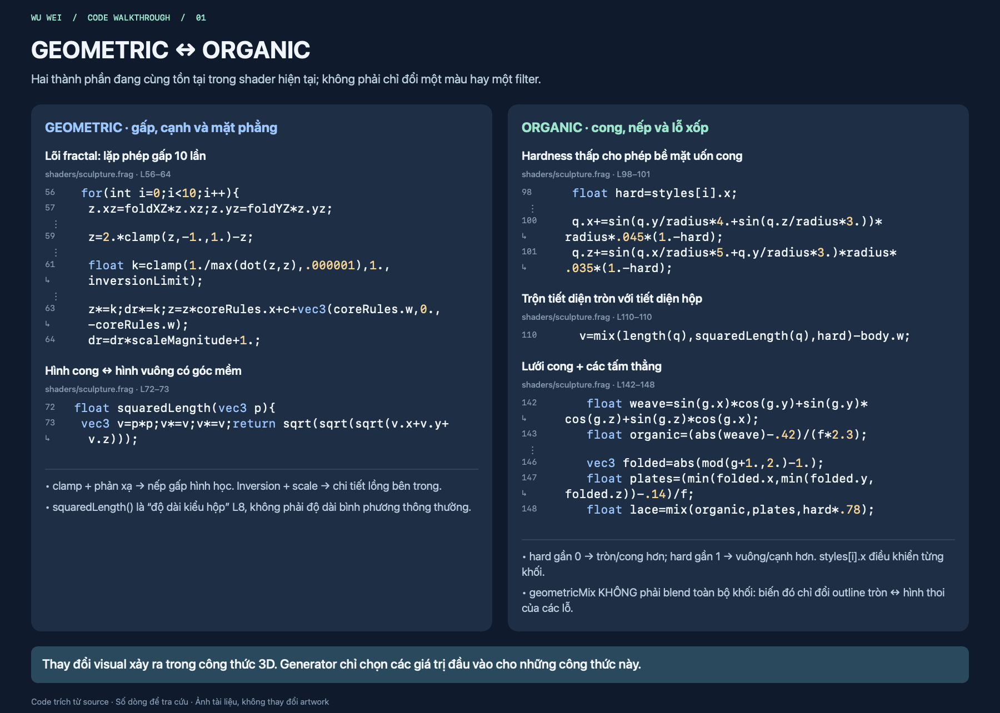
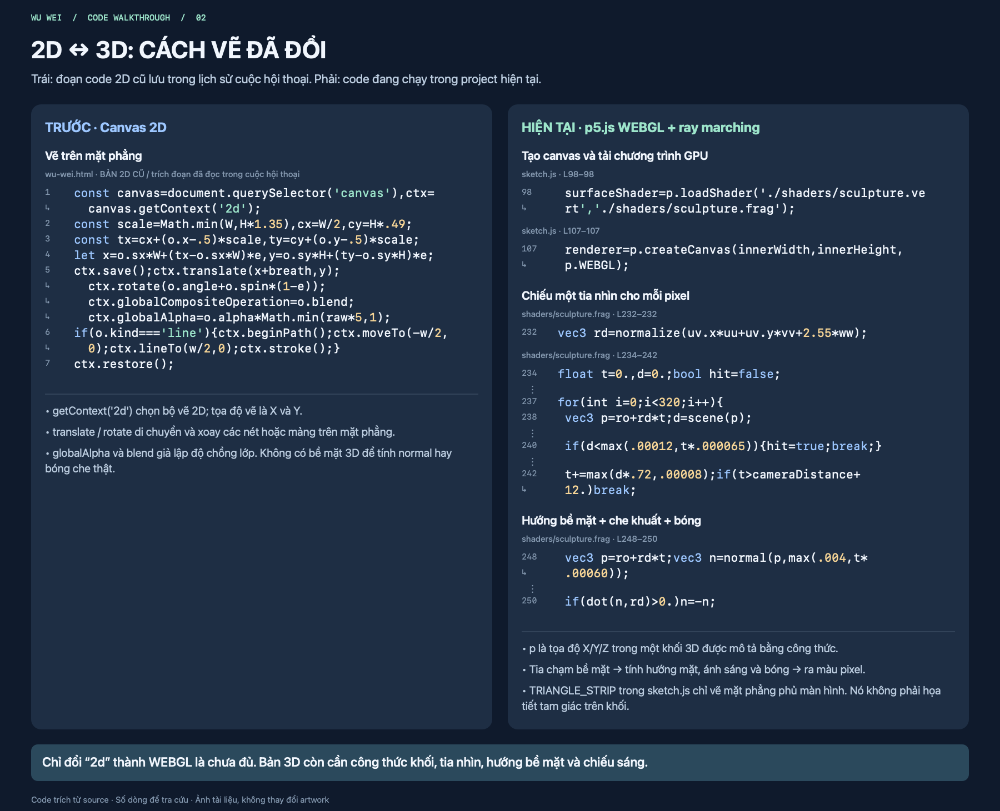
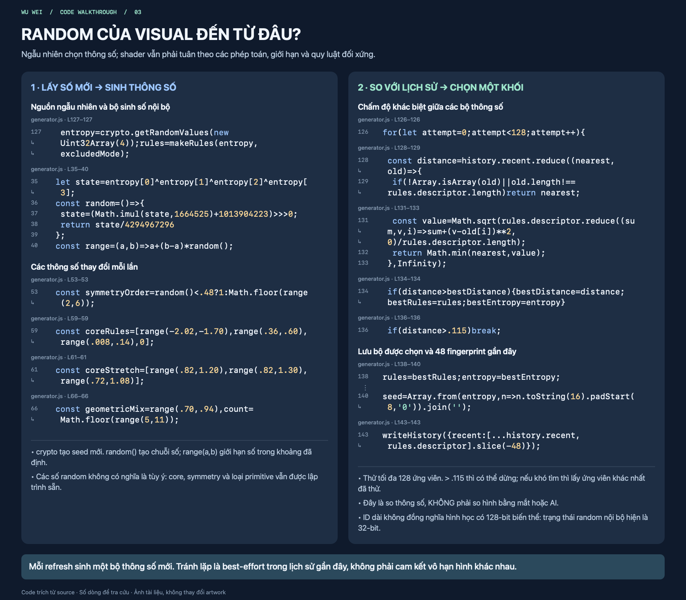
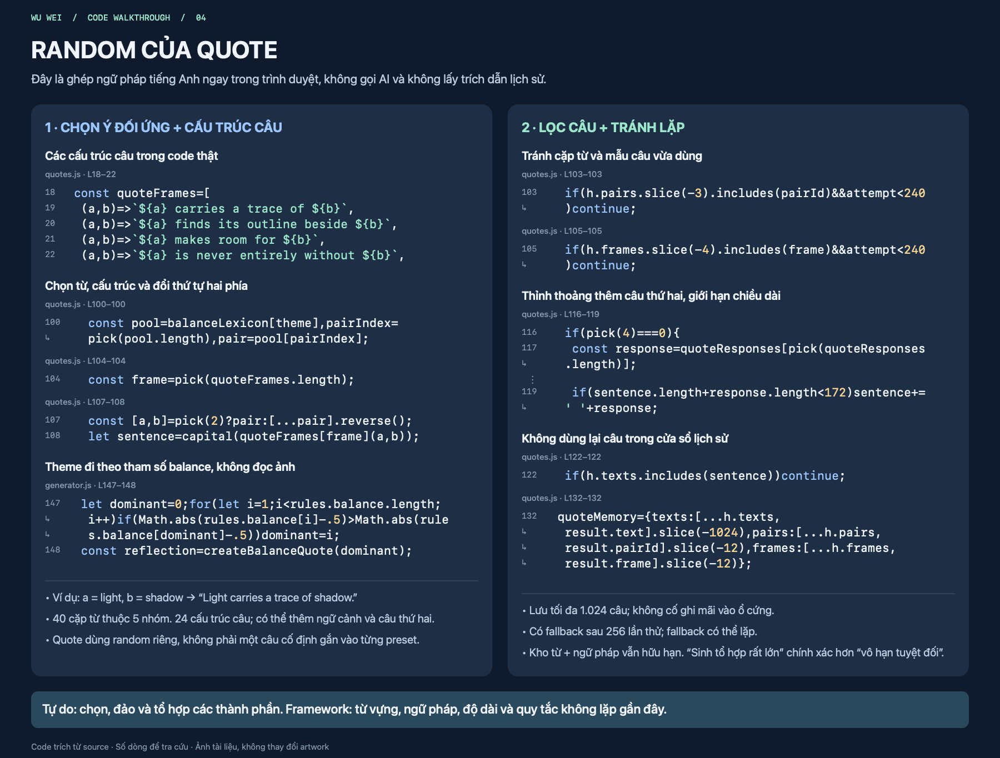
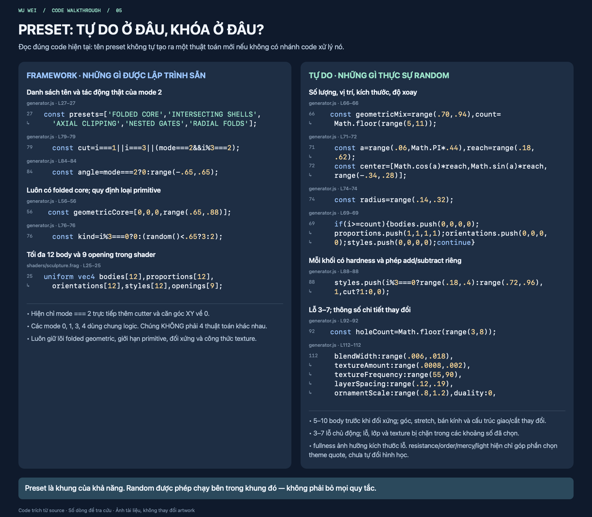
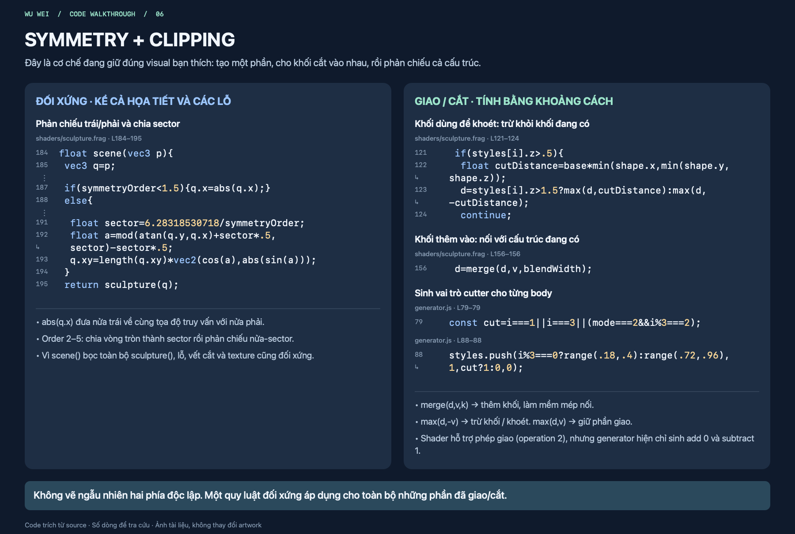

# Bộ ảnh giải thích code Wu Wei

Các PNG là ảnh trình bày các trích đoạn code thật, có số dòng và chú thích; không phải ảnh chụp cửa sổ VS Code. Code chạy của web không bị thay đổi.
Ảnh 02 dùng một đoạn 2D cũ đã đọc trong lịch sử cuộc hội thoại. Đoạn đó không nằm trong code hiện tại; số dòng ở khung lịch sử là số dòng trong trích đoạn.

Mở `index.html` trong thư mục này để xem cả bộ.

## GEOMETRIC ↔ ORGANIC

Thay đổi visual xảy ra trong công thức 3D. Generator chỉ chọn các giá trị đầu vào cho những công thức này.

**GEOMETRIC · gấp, cạnh và mặt phẳng**
- clamp + phản xạ → nếp gấp hình học. Inversion + scale → chi tiết lồng bên trong.
- squaredLength() là “độ dài kiểu hộp” L8, không phải độ dài bình phương thông thường.

**ORGANIC · cong, nếp và lỗ xốp**
- hard gần 0 → tròn/cong hơn; hard gần 1 → vuông/cạnh hơn. styles[i].x điều khiển từng khối.
- geometricMix KHÔNG phải blend toàn bộ khối: biến đó chỉ đổi outline tròn ↔ hình thoi của các lỗ.

## 2D ↔ 3D: CÁCH VẼ ĐÃ ĐỔI

Chỉ đổi “2d” thành WEBGL là chưa đủ. Bản 3D còn cần công thức khối, tia nhìn, hướng bề mặt và chiếu sáng.

**TRƯỚC · Canvas 2D**
- getContext('2d') chọn bộ vẽ 2D; tọa độ vẽ là X và Y.
- translate / rotate di chuyển và xoay các nét hoặc mảng trên mặt phẳng.
- globalAlpha và blend giả lập độ chồng lớp. Không có bề mặt 3D để tính normal hay bóng che thật.

**HIỆN TẠI · p5.js WEBGL + ray marching**
- p là tọa độ X/Y/Z trong một khối 3D được mô tả bằng công thức.
- Tia chạm bề mặt → tính hướng mặt, ánh sáng và bóng → ra màu pixel.
- TRIANGLE_STRIP trong sketch.js chỉ vẽ mặt phẳng phủ màn hình. Nó không phải họa tiết tam giác trên khối.

## RANDOM CỦA VISUAL ĐẾN TỪ ĐÂU?

Mỗi refresh sinh một bộ thông số mới. Tránh lặp là best-effort trong lịch sử gần đây, không phải cam kết vô hạn hình khác nhau.

**1 · LẤY SỐ MỚI → SINH THÔNG SỐ**
- crypto tạo seed mới. random() tạo chuỗi số; range(a,b) giới hạn số trong khoảng đã định.
- Các số random không có nghĩa là tùy ý: core, symmetry và loại primitive vẫn được lập trình sẵn.

**2 · SO VỚI LỊCH SỬ → CHỌN MỘT KHỐI**
- Thử tối đa 128 ứng viên. > .115 thì có thể dừng; nếu khó tìm thì lấy ứng viên khác nhất đã thử.
- Đây là so thông số, KHÔNG phải so hình bằng mắt hoặc AI.
- ID dài không đồng nghĩa hình học có 128-bit biến thể: trạng thái random nội bộ hiện là 32-bit.

## RANDOM CỦA QUOTE

Tự do: chọn, đảo và tổ hợp các thành phần. Framework: từ vựng, ngữ pháp, độ dài và quy tắc không lặp gần đây.

**1 · CHỌN Ý ĐỐI ỨNG + CẤU TRÚC CÂU**
- Ví dụ: a = light, b = shadow → “Light carries a trace of shadow.”
- 40 cặp từ thuộc 5 nhóm. 24 cấu trúc câu; có thể thêm ngữ cảnh và câu thứ hai.
- Quote dùng random riêng, không phải một câu cố định gắn vào từng preset.

**2 · LỌC CÂU + TRÁNH LẶP**
- Lưu tối đa 1.024 câu; không cố ghi mãi vào ổ cứng.
- Có fallback sau 256 lần thử; fallback có thể lặp.
- Kho từ + ngữ pháp vẫn hữu hạn. “Sinh tổ hợp rất lớn” chính xác hơn “vô hạn tuyệt đối”.

## PRESET: TỰ DO Ở ĐÂU, KHÓA Ở ĐÂU?

Preset là khung của khả năng. Random được phép chạy bên trong khung đó — không phải bỏ mọi quy tắc.

**FRAMEWORK · NHỮNG GÌ ĐƯỢC LẬP TRÌNH SẴN**
- Hiện chỉ mode === 2 trực tiếp thêm cutter và căn góc XY về 0.
- Các mode 0, 1, 3, 4 dùng chung logic. Chúng KHÔNG phải 4 thuật toán khác nhau.
- Luôn giữ lõi folded geometric, giới hạn primitive, đối xứng và công thức texture.

**TỰ DO · NHỮNG GÌ THỰC SỰ RANDOM**
- 5–10 body trước khi đối xứng; góc, stretch, bán kính và cấu trúc giao/cắt thay đổi.
- 3–7 lỗ chủ động; lỗ, lớp và texture bị chặn trong các khoảng số đã chọn.
- fullness ảnh hưởng kích thước lỗ. resistance/order/mercy/light hiện chỉ góp phần chọn theme quote, chưa tự đổi hình học.

## SYMMETRY + CLIPPING

Không vẽ ngẫu nhiên hai phía độc lập. Một quy luật đối xứng áp dụng cho toàn bộ những phần đã giao/cắt.

**ĐỐI XỨNG · KỂ CẢ HỌA TIẾT VÀ CÁC LỖ**
- abs(q.x) đưa nửa trái về cùng tọa độ truy vấn với nửa phải.
- Order 2–5: chia vòng tròn thành sector rồi phản chiếu nửa-sector.
- Vì scene() bọc toàn bộ sculpture(), lỗ, vết cắt và texture cũng đối xứng.

**GIAO / CẮT · TÍNH BẰNG KHOẢNG CÁCH**
- merge(d,v,k) → thêm khối, làm mềm mép nối.
- max(d,-v) → trừ khối / khoét. max(d,v) → giữ phần giao.
- Shader hỗ trợ phép giao (operation 2), nhưng generator hiện chỉ sinh add 0 và subtract 1.

## Cách hiểu tổng thể

`generator.js` chọn thông số → `sculpture.frag` biến thông số thành hình → `scene()` áp dụng đối xứng → ray marching + lighting vẽ ra pixel. `quotes.js` tự ghép câu từ cùng nhóm ý niệm, không phân tích ảnh.

Giới hạn đáng chú ý: bộ từ và cấu trúc quote hữu hạn; RNG hình có trạng thái 32-bit; đối chiếu fingerprint chỉ là chống gần giống thông số. Không có bảo đảm vô hạn không trùng.

Các ảnh là bản chụp tĩnh của source tại thời điểm tạo tài liệu; khi sửa code về sau, số dòng và nội dung ảnh sẽ không tự cập nhật.
